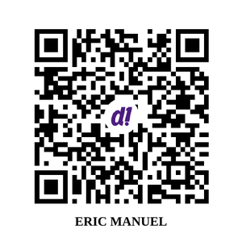

### Hola, soy Eric 👋 / Hi, I'm Eric

Applied AI engineer in Quito, Ecuador · agents, RAG & guardrails on Cloudflare · 15+ years shipping web platforms (Drupal → Cloudflare) · Master's in AI, USFQ (2026) · ultra trail runner.

**Open source**
- [artifacts-manager](https://github.com/ericmaster/artifacts-manager): hub to browse agent-generated HTML/Markdown artifacts across repos
- [agent-fabric](https://github.com/ericmaster/agent-fabric): portable Agent Fabric CLI
- [skills-manager](https://github.com/ericmaster/skills-manager): manage agentskills.io skills across AI coding agents
- [taller-openclaw](https://github.com/ericmaster/taller-openclaw): taller de agentes con OpenClaw (FLISOL 2026, Quito)

**Links:** [ericmaster.ninja](https://ericmaster.ninja) · [LinkedIn](https://www.linkedin.com/in/eric-aguayo/) · [Drupal.org](https://www.drupal.org/u/ericmaster)

#### ☕ Cómprame un café / Buy me a coffee
Si algo de lo que publico te sirvió, invítame un café con DeUna (Ecuador). / If something I published helped you, buy me a coffee via DeUna.

Funciona desde la app DeUna o la app de tu banco ecuatoriano compatible con DeUna. 
